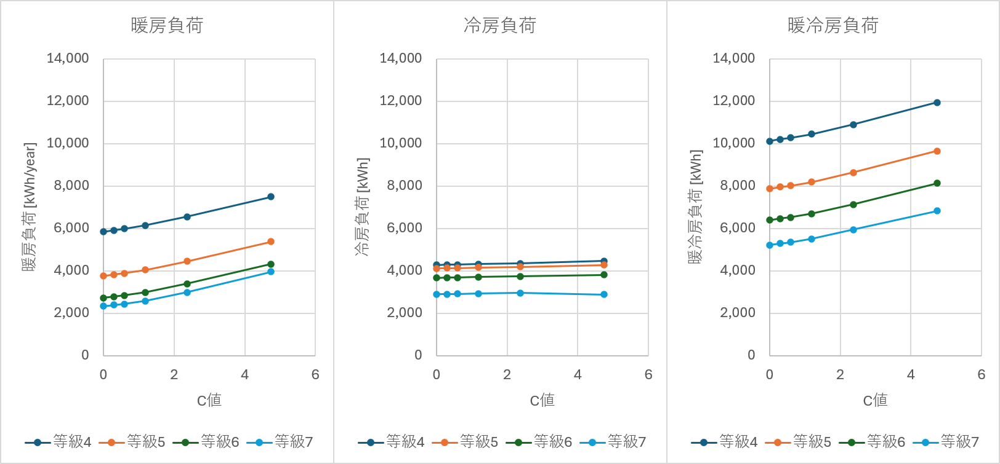
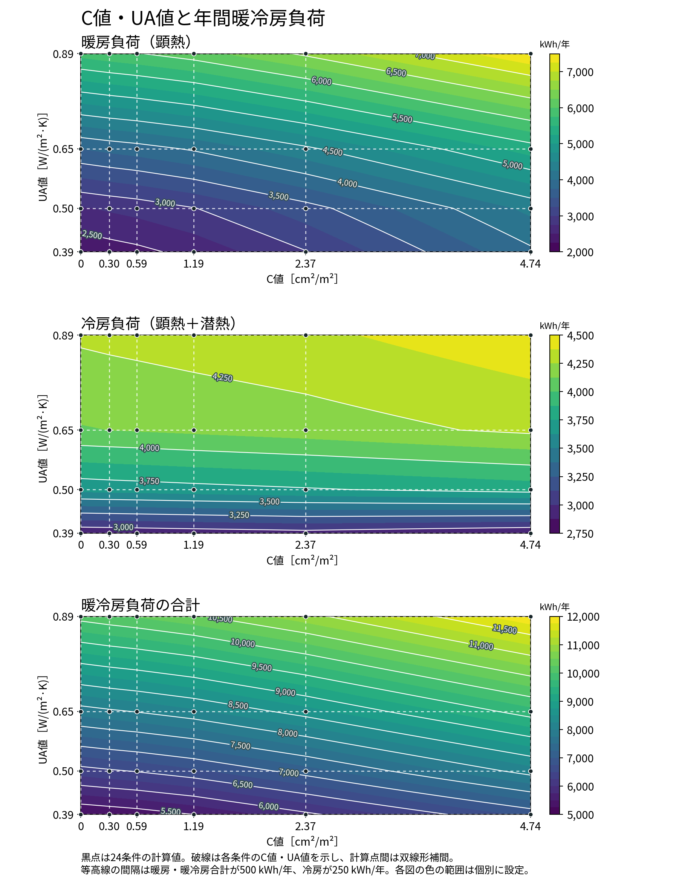
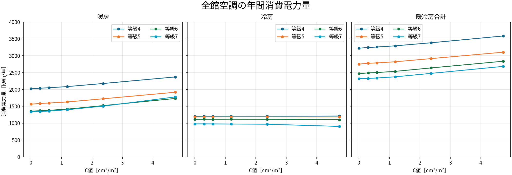
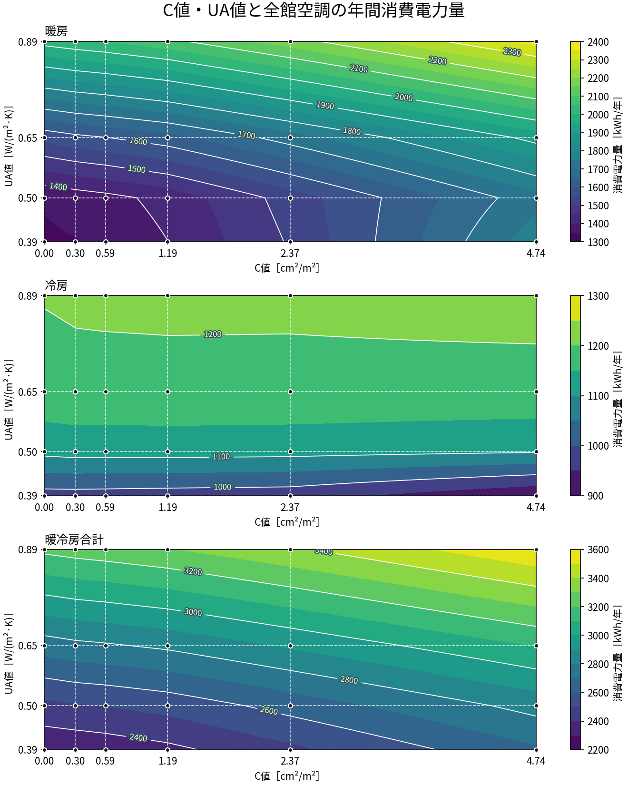

# 標準住宅の断熱等級・隙間倍率と暖冷房負荷

標準住宅について、断熱等級4～7と隙間倍率0、0.5、1、2、4、8を組み合わせた24条件を比較した年間計算と、最寒週・最暑週の時系列結果です。

## レポートの閲覧

[年間・週間グラフをダウンロード（ZIP）](https://github.com/iguchi-lab/standard-house-airtightness-study/raw/refs/heads/main/reports/standard_house_reports.zip)

ZIPを展開し、週間グラフは `standard_house_extreme_weeks.html`、年間グラフは `standard_house_annual_report.html` をブラウザで開いてください。週間版には24条件×2週の時系列を内蔵しています。条件と表示室を選んで閲覧できます。

[主要8室の週間温湿度・箱ひげ図をダウンロード（ZIP）](https://github.com/iguchi-lab/standard-house-airtightness-study/raw/refs/heads/main/reports/weekly_room_boxplots.zip)

展開して `weekly_room_boxplots.html` を開くと、最寒週・最暑週の温度、相対湿度、絶対湿度を切り替え、各室の24条件を横並びで比較できます。

## レポートのファイル

- [年間計算レポート（HTMLソース）](reports/standard_house_annual_report.html)
- [年間計算レポート（Excel）](reports/standard_house_annual_report.xlsx)
- [最寒週・最暑週レポート（HTMLソース）](reports/standard_house_extreme_weeks.html)

## 年間負荷とC値・UA値

折れ線図の各点は、等級別・C値別の年間計算結果です。左から暖房顕熱、冷房合計（顕熱＋潜熱）、暖冷房合計を示します。縦軸は3図とも0～14,000 kWh/年です。

等高線図の黒点は24の計算条件、破線は各条件のC値とUA値です。計算点間は双線形補間しています。土間外周の線熱貫流率を0.99 W/(m·K)としたとき、等級4～7仕様のUA値は順に0.89、0.65、0.50、0.39 W/(m²·K)です。

## 全館空調の年間消費電力量

暖房・冷房の運転モード別に、1時間ごとの空調消費電力を年間8,760時間について積算しました。24条件すべてで、暖冷房合計が既存の年間集計値と一致しています。

等高線図の黒点は計算条件、破線はC値・UA値のグリッドです。点間は双線形補間し、色の範囲は各図で個別に設定しています。

[24条件の年間消費電力量（CSV）](data/annual_electricity.csv)

## 検証済みデータ

- [年間24条件の集計](data/matrix-snapshot.json)
- [最寒週・最暑週の時系列48ファイル](data/extreme-weeks/)
- [検証結果](data/verification.json)

年間計算は全24条件で対象期間8,760時間を確認しています。暖房は顕熱負荷、冷房は顕熱と潜熱の合計、暖冷房合計は両者の和です。増減率は各断熱等級内の隙間倍率×1を基準として、`(対象 ÷ 基準 − 1) × 100` で算出しています。

最寒週は2月19～25日、最暑週は7月27日～8月2日です。全48ファイルで168時間の室別温度・相対湿度・絶対湿度、全館空調負荷、消費電力を確認しています。

## 計算再開について

計算が停止した等級5×8、等級7×4、等級7×8は、停止前の連続計算結果と重複期間を設けた再開計算結果を時刻で接続しました。等級7×8の再開部分では、低負荷時の風量制御振動を避けるため風量一致判定を0.02 m³/sとしました。接続後の年間対象8,760時間が連続してそろうことを検証しています。

## 再計算用ノート

- [Colabノート](standard_house_airtightness_insulation_matrix.ipynb)
